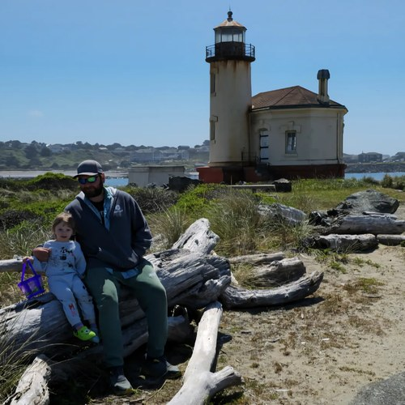

# Preston Winters

[](mailto:preston@winterscode.com)
[](https://winterscode.com)
[](https://github.com/Preston2012?tab=repositories&q=&language=typescript)
[](https://github.com/Preston2012?tab=repositories&q=&language=dart)
[](https://github.com/Preston2012?tab=repositories&q=&language=astro)
[](https://github.com/Preston2012?tab=repositories&q=&language=python)

<p align="center">
  
  &nbsp;&nbsp;
  
</p>

Solo builder in Bandon, Oregon. AI memory, consumer products, governance architecture, and client web work through [Winters Code](https://winterscode.com).

The full circle:

```
  Demiurge  ──►  MyKonos  ──►  Ouroboros
  (engine)      (consumer)     (governance)

  How memory     What it       What memory
  should work    feels like    means at scale
```

Open-source the engine, build the consumer product on top, write the governance architecture this technology demands. One thesis across three layers: **personalization belongs to the person.**

---

## Active work

### [Demiurge](https://github.com/Preston2012/demi). The memory engine.

Refusal-first adaptive memory for AI agents. Quality-gated at the write boundary. Surfaces conflicts instead of hiding them. Hash-chain audit log for every read, write, and amendment.

TypeScript, SQLite + sqlite-vec + FTS5, BGE-small ONNX embeddings, SQLCipher encryption-at-rest. Ships as MCP server + REST API. Runs on a $6/mo ARM VPS.

Public benchmarks across 14 evaluations: LOCOMO, BEAM, LongMemEval, CloneMem, MemoryAgentBench, plus an in-house safety suite (FRAME-INJECT, FRAME-SYBIL, FRAME-AUDIT, VAULT) and product-correctness suite (attribution, paraphrase, ECE/Brier, recall@K, stale-memory). Live scorecard in the [demi repo README](https://github.com/Preston2012/demi).

### MyKonos

Personal AI companion built on Demiurge, with BYOK multi-model routing. The memory-active visual primitive lights up the UI when MyKonos pulls something it learned about you, instead of hiding the retrieval behind a black box.

Mobile-first. Proprietary. In active development, not yet open for general use. The reference consumer implementation of Memory Sovereignty Principles (below). The engine is open. The product is what it looks like when you actually use it.

### [Ouroboros](https://github.com/Preston2012/ouroboros). Self-auditing governance.

Governance that starts at the size of one community, grows only by consent, uses AI as a tool, and keeps humans in charge of every real decision. It gives everyone a floor to stand on and repairs itself on a schedule instead of rotting.

v2.6 is public, with every amendment logged and its reason given. The [Objection Register](https://github.com/Preston2012/ouroboros/blob/main/REGISTER.md) is open: every objection gets a permanent numbered entry, whether it wins or not, including the ones I cannot answer yet.

This isn't a side project. It's the reason the engine and the companion exist. Memory, personalization, and AI mediation at scale require governance. Someone has to write the proposal.

### Chere'

Field-service platform: unified inbox, scheduling, and billing in one Flutter app, with a dedicated build for [SeaBreeze](https://seabreeze.llc). Formerly Work-Flow.

---

## How I build

### No model works solo

Every build runs through checks and balances across models. Claude builds. GPT, Gemini, and Grok review, challenge, and red-team the work, and product pull requests get an outside automated review before they merge. Disagreements are reconciled, not averaged. What each round teaches goes into an operating rule library, and a rule is promoted only after it clears a dedup and specificity gate.

[AI Council](https://github.com/Preston2012/ai-council) was the first public version of this method. It is archived; the method now runs as a standing review fleet.

### Memory Sovereignty Principles. In draft.

A spec with executable contracts for AI memory providers. Ten principles covering local-first, portable export, hard delete with verification, encryption with user-held keys, provenance disclosure, refusal-first injection, no cross-tenant leakage, right to amendment, no silent retraining, open audit log.

Drafting v1.0. Eight of the ten principles have a runnable contract so far. No provider has been scored yet; the scorecard comes after the contracts.

---

## Winters Code

Web studio on the Oregon coast. Astro and Tailwind on Cloudflare, built to a quality floor: responsive from 320 to 1920 px, per-device modern image formats, and accessibility checked before launch. Eight client sites live. See the [work](https://winterscode.com/work).

## Products

**[Baseline](https://baseline.marketing)** ([showcase](https://github.com/Preston2012/baseline-showcase)). Political intelligence platform. Tracks 100+ public figures across 4 AI providers. Consensus scoring detects bias no single model catches. 28 Flutter screens, 22 Supabase Edge Functions, 5,400+ analyzed statements.

**StainSlayer.** AI stain removal guidance: photo plus fabric type in, step-by-step removal instructions out, in Standard, Eco, Emergency, and Fun modes. Published on Google Play and the App Store, retired in November 2026.

---

## Stack

TypeScript, Dart/Flutter, Python, Astro + Tailwind, Supabase/PostgreSQL, SQLite + sqlite-vec, ONNX Runtime, Cloudflare (Pages, Workers, R2), MCP. Claude, GPT, Gemini, Grok, DeepSeek APIs.

## Contact

[baseline.marketing](https://baseline.marketing) · [winterscode.com](https://winterscode.com) · [preston@winterscode.com](mailto:preston@winterscode.com) · [LinkedIn](https://linkedin.com/in/prestonwinters)

---

**Open to collaboration and technical partnerships** in AI memory, agent systems, and governance. Building independently through [Winters Code](https://winterscode.com) on the Oregon coast.

*If you are building memory infrastructure, working on AI governance at scale, or want to put any of this to work, get in touch.*
